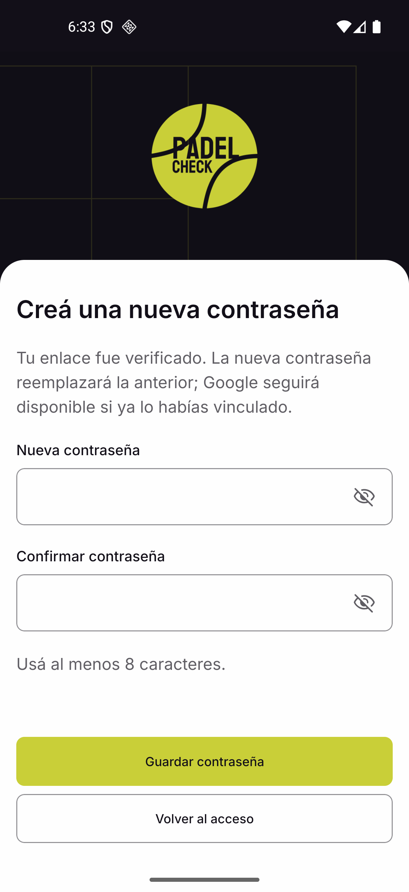
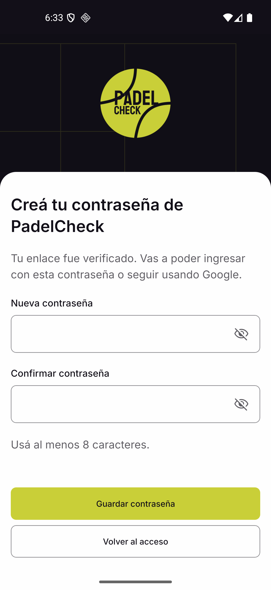

# KAN-214 — Android / iOS recovery

Verified 03/11/2026. Code implements `/forgot-password` and `/reset-password` for
Android/iOS, shared by player and club. Server contract v1.1 is integrated from
KAN-215 PRs #10/#12. `+native-intent` removes the proof before Expo routing and
assigns a non-secret attempt ID so cold/warm links replace the previous form and
capability. Proof/password remain in memory, never router params or SecureStore.

## Android installed application

`assembleRelease` passed; installed standalone APK uses embedded Hermes and runs
without Metro or Expo Go. Local QA build targets the loopback test API through
the emulator and enables cleartext only in the ignored generated Android manifest.
This is a local release-mode build, not a store distribution. Source configuration
retains the existing scheme `padelcheck`; hosted API configuration requires HTTPS.

`android-results.json` records five suites against real API/PostgreSQL and local
SMTP. Captures at 1080×2340, density 440 (~393×851 dp):

- Login → recovery; required field, keyboard, generic real request and confirmation.
- Local password and no-local-password accounts: email URL opened with installed
  app both force-stopped and running; server-selected variants; validation, explicit
  Save, success → login, new password accepted, consumed URL unavailable.
- A second warm URL replaces an already-open form and changes RESET to CREATE
  according to the new server capability; missing proof has the same unavailable state.

These were Android VIEW intents using the URL received by the local email collector;
they do not claim a tap inside Gmail/Outlook or external mail delivery.

## Visual comparison

[KAN-223 Figma](https://www.figma.com/design/6ChpVD5gKDoC3kRXoGdVdK/Padel-check?node-id=2887-45910):
request `2887:45731`, first password `2887:45836`, reset `2887:45910`, success
`2887:45984`. KAN-212 supplies the generic confirmation/validation/unavailable copy.

`android-final-results.json` and `android-final-*-402.png` cover the final installed
revision at 1206×2622, density 480 = 402×874 dp. Reference screenshots are preserved
in the web PR. Compared original assets/icons, Inter weights and line heights,
204 dp brand, 104×102.525 logo, 24 dp surface radius, 56 dp fields, 48 dp actions,
20 dp content gaps and colors. System bars are native; actual insets are applied
once. Footer uses real bottom inset +24 dp instead of copying Figma's illustrative
58 px. Keyboard reduces the brand, Android resize / iOS avoidance and scrolling
keep fields/actions reachable; focused confirmation scrolls into view.

Final reset:

Final first password:

Other evidence: [request](android-final-request-402.png),
[keyboard](android-final-keyboard-402.png), [success](android-final-success-402.png),
[warm replacement](android-replaced-open-screen.png), [missing link](android-missing.png),
[field errors](android-password-required.png), [used link](android-used.png).

## Automated checks and limitations

- Typecheck: pass. Recovery: 15 tests; HTTP: 24; session: 11; startup: 7, all pass
  with Node 24. Node 20's older MockTimers API cannot run the existing startup test.
- State/transport tests cover both capabilities, validations, failures, duplicates,
  Retry-After, cancellation, unknown action, invalid/expired/used/replaced proof,
  failed local cleanup and non-resubmitting cleanup retry. Public requests omit
  bearer/cookies; success clears SecureStore session/private query cache before
  offering login. Password strings are never trimmed.
- iOS platform bundle export passes. **Installed iOS remains pending:** this Windows
  host has no Mac/Xcode or connected installed iOS app. Cold/warm scheme opening,
  iOS keyboard/VoiceOver/safe areas and visual acceptance require that runtime.
  Export/typecheck and Android evidence do not accept those AC. Google identity and
  actual sign-in remain KAN-231; no claim of Google OAuth verification here.
- Guard lite: pass, no Critical open. No tenant/authz expansion, account duplication,
  credential persistence, logging of proof, or automatic login introduced.

Companion service PR exposes Retry-After through existing CORS policy; allowed
origins are unchanged. Web verified a real cross-origin 429. This delivery is for
review with explicit iOS verification remaining; no merge, deploy or publication.
